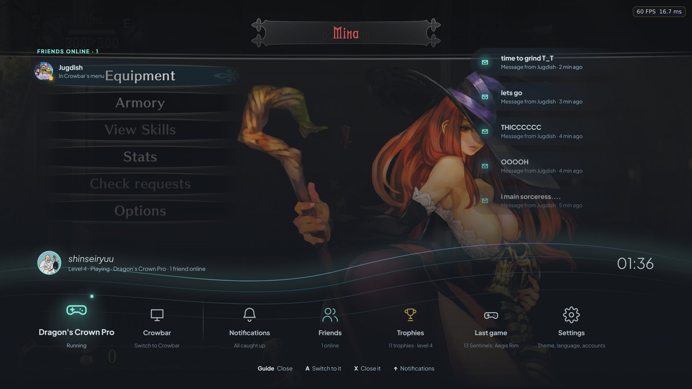
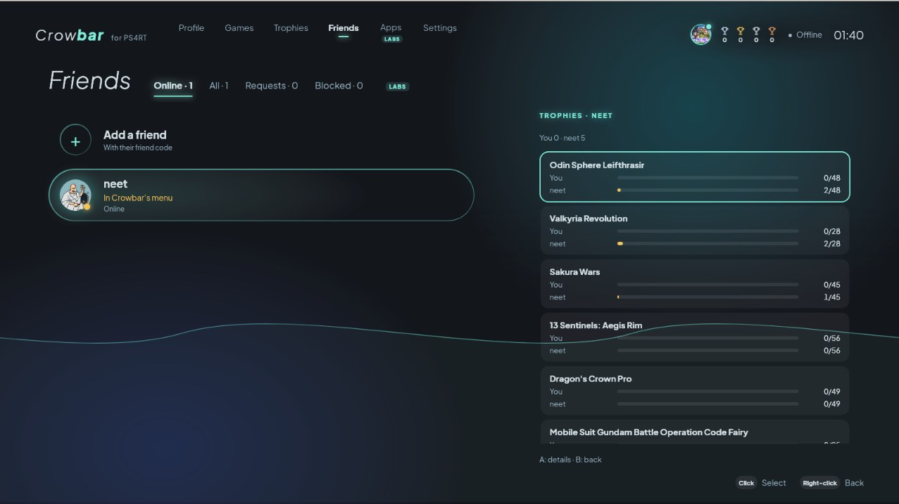
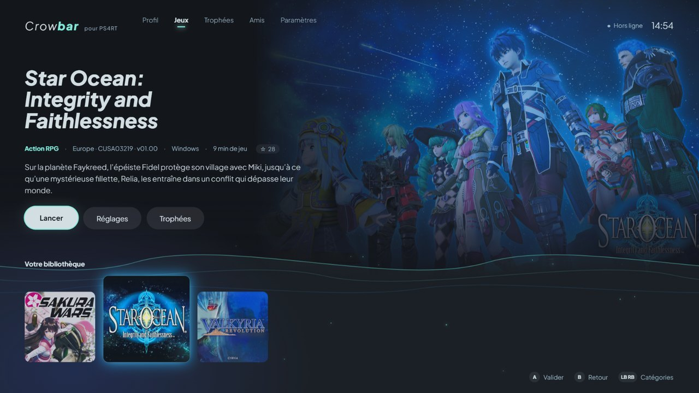
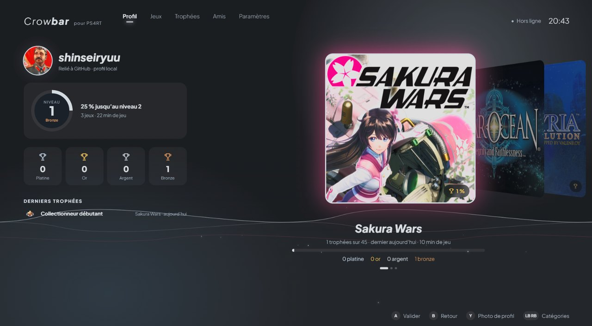
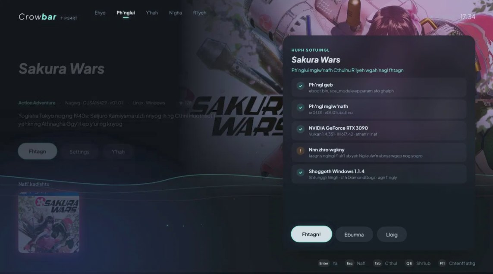
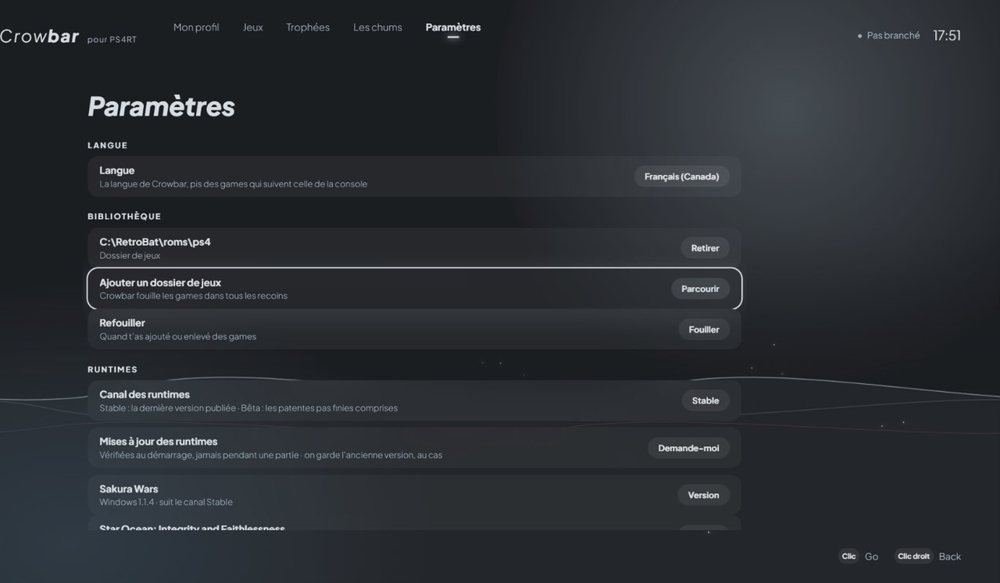

# Crowbar

**Crowbar** is a launcher for PS4RT runtimes. It finds your PS4 game dumps, installs and updates the right runtime for each game, and launches them, from a controller, a keyboard or a mouse.

**[Download the latest release](https://github.com/DiamondDogz/crowbar/releases)**: `Crowbar_*_x64-setup.exe` for Windows, `.AppImage` or `.deb` for Linux. Each file comes with its `.sha256`.

No game is included. Crowbar only runs games from your own dumps.

Version française plus bas.

  

<i>Guide during a game: the menu opens over Dragon's Crown Pro, with your friends online and their messages.</i>

## Games

| Game | Windows | Linux | By |
| --- | --- | --- | --- |
| Sakura Wars | [Sakura-Wars-PS4RT-Windows](https://github.com/DiamondDogz/Sakura-Wars-PS4RT-Windows) | [Sakura-Wars-PS4RT](https://github.com/HekamiAeon/Sakura-Wars-PS4RT) | [HekamiAeon](https://github.com/HekamiAeon), Windows port by DiamondDogz |
| Valkyria Revolution | [Valkyria-Revolution-PS4RT-Windows](https://github.com/DiamondDogz/Valkyria-Revolution-PS4RT-Windows) | [valkyria-revolution-ps4rt](https://github.com/HekamiAeon/valkyria-revolution-ps4rt) | [HekamiAeon](https://github.com/HekamiAeon), Windows port by DiamondDogz |
| Mobile Suit Gundam Battle Operation Code Fairy | [GBO-Code-Fairy-PS4RT-Windows](https://github.com/DiamondDogz/GBO-Code-Fairy-PS4RT-Windows) | [GBO-Code-Fairy-PS4RT](https://github.com/HekamiAeon/GBO-Code-Fairy-PS4RT) | [HekamiAeon](https://github.com/HekamiAeon), Windows port by DiamondDogz |
| Star Ocean: Integrity and Faithlessness | [Star-Ocean-Integrity-and-Faithlessness-PS4RT](https://github.com/Hoverbike51/Star-Ocean-Integrity-and-Faithlessness-PS4RT) | [Star-Ocean-Integrity-and-Faithlessness-PS4RT](https://github.com/HekamiAeon/Star-Ocean-Integrity-and-Faithlessness-PS4RT) | [Hoverbike51](https://github.com/Hoverbike51) (Windows), [HekamiAeon](https://github.com/HekamiAeon) (Linux) |
| Dragon's Crown Pro | [dragons-crown-pro-pc](https://github.com/saulob/dragons-crown-pro-pc) | [dragons-crown-pro-pc](https://github.com/saulob/dragons-crown-pro-pc) | [saulob](https://github.com/saulob) |
| Odin Sphere Leifthrasir | [odin-sphere-leifthrasir-pc](https://github.com/saulob/odin-sphere-leifthrasir-pc) | [odin-sphere-leifthrasir-pc](https://github.com/saulob/odin-sphere-leifthrasir-pc) | [saulob](https://github.com/saulob) |
| 13 Sentinels: Aegis Rim | [13-sentinels-aegis-rim-pc](https://github.com/saulob/13-sentinels-aegis-rim-pc) | [13-sentinels-aegis-rim-pc](https://github.com/saulob/13-sentinels-aegis-rim-pc) | [saulob](https://github.com/saulob) |

Every runtime records trophies. The list comes from [crowbar-catalog](https://github.com/DiamondDogz/crowbar-catalog) and is refreshed every ten minutes, so new versions show up without restarting Crowbar. Enjoying a game? Star its repo: press Y on it in Crowbar, or follow the links above.

## New in 0.2.9

- **A real pause from the Guide button.** Sakura Wars, Gundam Code Fairy and Valkyria Revolution stop completely (picture, sound, timers) while the menu is open. When a game cannot stop right now, a short notice says so, as on a console.
- **Quit game, cleanly**: the runtime saves and closes itself; a game quit early is no longer reported as a crash.
- **Live trophies**: a banner over the game, and your profile updates right away.
- **Button prompts** in games: PlayStation or Xbox, for runtimes that support it.
- **Captures and mods**: a Captures gallery for runtimes that save screenshots, and a mods folder in the game's Add-ons.
- **Friends** (Labs, peer to peer, no server): who is online and what they play, right in the Guide; trophy comparison; their new trophies as banners; and **messages**, delivered at once or carried by other players for up to 14 days.

  

<i>Comparing trophies with a friend, game by game.</i>

## What it does

- **Library**: point Crowbar at the folder of your dumps. It reads each game's title, CUSA number, version and region, and shows the game's own icon, background and theme music.
- **Runtimes**:
  - installed for you on first launch, checked against their SHA-256;
  - updated automatically or on demand, on the stable or beta channel;
  - pinned to an exact version if you prefer;
  - your saves, trophies and settings follow every update, and the previous version stays available to go back to.
- **Trophies**: read from each game's `trophy00.trp`, with a Trophies screen, progress on every cover, a profile page and live banners. Nothing is sent to any server.
- **Per-game settings**: resolution, display mode, FSR, frame rate and filtering. What you change in the in-game menu is kept.
- **Checks before launch**: game files and version, Vulkan 1.3 support and a controller. If something would stop the game, Crowbar says what to do.
- **Backups**: a dated copy of your saves, trophies and settings before every runtime change, with export, import and restore.
- **23 languages**, those of the PS4. As on the console, one system language serves both Crowbar and the games that follow it.
- **Guide menu over the game**: pause, switch to Crowbar, quit the game, see notifications and friends, without leaving it.
- **Console mode**: full screen, out of the way while you play, back when you quit. A Steam shortcut and a Discord activity are available.
- **GitHub account**, optional: one press to star the runtimes you enjoy. Sign-in uses a device code, so no password goes through Crowbar.

## Screenshots

<table>
  <tr>
    <td colspan="2"></td>
  </tr>
  <tr>
    <td colspan="2" align="center"><i>Your library: each game with its own artwork and theme music.</i></td>
  </tr>
  <tr>
    <td colspan="2"></td>
  </tr>
  <tr>
    <td colspan="2" align="center"><i>Your profile: level, trophies earned and progress in each game.</i></td>
  </tr>
  <tr>
    <td width="50%"></td>
    <td width="50%"></td>
  </tr>
  <tr>
    <td align="center"><i>Checks before launch, in the bonus language: R'lyehian.</i></td>
    <td align="center"><i>Settings, in Canadian French, one of the 23 PS4 languages.</i></td>
  </tr>
</table>

## Requirements

- Windows 10 or 11 (x64), or a Linux desktop.
- A graphics card with Vulkan 1.3.
- Your own extracted PS4 game dumps.
- A controller is recommended, not required.

## Licence

Crowbar is free to download and use for personal use. Its source code is not public. See the licence shipped with each build. Crowbar includes third-party components under their own licences, listed in `THIRD-PARTY-NOTICES.txt` with every build.

Crowbar is not affiliated with Sony Interactive Entertainment or with the publishers of the games it launches. "PlayStation" and "PS4" are trademarks of their respective owners. The runtimes belong to their authors; credit for them stays with them.

---

# Crowbar (français)

**Crowbar** est un lanceur pour les runtimes PS4RT. Il trouve vos dumps de jeux PS4, installe et met à jour le bon runtime pour chaque jeu, et les lance, à la manette, au clavier ou à la souris.

**[Télécharger la dernière version](https://github.com/DiamondDogz/crowbar/releases)** : `Crowbar_*_x64-setup.exe` pour Windows, `.AppImage` ou `.deb` pour Linux. Chaque fichier est accompagné de son `.sha256`.

Aucun jeu n'est inclus. Crowbar ne lance que vos propres dumps.

  

<i>Le Guide pendant une partie : le menu s'ouvre par-dessus Dragon's Crown Pro, avec vos amis en ligne et leurs messages.</i>

## Jeux

| Jeu | Windows | Linux | Par |
| --- | --- | --- | --- |
| Sakura Wars | [Sakura-Wars-PS4RT-Windows](https://github.com/DiamondDogz/Sakura-Wars-PS4RT-Windows) | [Sakura-Wars-PS4RT](https://github.com/HekamiAeon/Sakura-Wars-PS4RT) | [HekamiAeon](https://github.com/HekamiAeon), portage Windows par DiamondDogz |
| Valkyria Revolution | [Valkyria-Revolution-PS4RT-Windows](https://github.com/DiamondDogz/Valkyria-Revolution-PS4RT-Windows) | [valkyria-revolution-ps4rt](https://github.com/HekamiAeon/valkyria-revolution-ps4rt) | [HekamiAeon](https://github.com/HekamiAeon), portage Windows par DiamondDogz |
| Mobile Suit Gundam Battle Operation Code Fairy | [GBO-Code-Fairy-PS4RT-Windows](https://github.com/DiamondDogz/GBO-Code-Fairy-PS4RT-Windows) | [GBO-Code-Fairy-PS4RT](https://github.com/HekamiAeon/GBO-Code-Fairy-PS4RT) | [HekamiAeon](https://github.com/HekamiAeon), portage Windows par DiamondDogz |
| Star Ocean: Integrity and Faithlessness | [Star-Ocean-Integrity-and-Faithlessness-PS4RT](https://github.com/Hoverbike51/Star-Ocean-Integrity-and-Faithlessness-PS4RT) | [Star-Ocean-Integrity-and-Faithlessness-PS4RT](https://github.com/HekamiAeon/Star-Ocean-Integrity-and-Faithlessness-PS4RT) | [Hoverbike51](https://github.com/Hoverbike51) (Windows), [HekamiAeon](https://github.com/HekamiAeon) (Linux) |
| Dragon's Crown Pro | [dragons-crown-pro-pc](https://github.com/saulob/dragons-crown-pro-pc) | [dragons-crown-pro-pc](https://github.com/saulob/dragons-crown-pro-pc) | [saulob](https://github.com/saulob) |
| Odin Sphere Leifthrasir | [odin-sphere-leifthrasir-pc](https://github.com/saulob/odin-sphere-leifthrasir-pc) | [odin-sphere-leifthrasir-pc](https://github.com/saulob/odin-sphere-leifthrasir-pc) | [saulob](https://github.com/saulob) |
| 13 Sentinels: Aegis Rim | [13-sentinels-aegis-rim-pc](https://github.com/saulob/13-sentinels-aegis-rim-pc) | [13-sentinels-aegis-rim-pc](https://github.com/saulob/13-sentinels-aegis-rim-pc) | [saulob](https://github.com/saulob) |

Chaque runtime enregistre les trophées. La liste vient de [crowbar-catalog](https://github.com/DiamondDogz/crowbar-catalog), relue toutes les dix minutes : les nouvelles versions apparaissent sans relancer Crowbar. Un jeu vous plaît ? Mettez une étoile à son dépôt : Y sur le jeu dans Crowbar, ou les liens ci-dessus.

## Nouveau dans la 0.2.9

- **Une vraie pause avec le bouton Guide.** Sakura Wars, Gundam Code Fairy et Valkyria Revolution s'arrêtent complètement (image, son, minuteries) pendant que le menu est ouvert. Quand un jeu ne peut pas s'arrêter tout de suite, un court avis le dit, comme sur console.
- **Quitter le jeu proprement** : le runtime enregistre et se ferme lui-même ; un jeu quitté tôt n'est plus signalé comme un plantage.
- **Trophées en direct** : un bandeau par-dessus le jeu, et votre profil se met à jour aussitôt.
- **Boutons affichés** dans les jeux : PlayStation ou Xbox, pour les runtimes qui le permettent.
- **Captures et mods** : une galerie Captures pour les runtimes qui enregistrent des captures, et un dossier de mods dans les Contenus du jeu.
- **Amis** (Labs, de joueur à joueur, sans serveur) : qui est en ligne et à quoi il joue, directement dans le Guide ; comparaison des trophées ; leurs nouveaux trophées en bandeau ; et les **messages**, remis tout de suite ou portés par d'autres joueurs jusqu'à 14 jours.

  

<i>La comparaison des trophées avec un ami, jeu par jeu.</i>

## Ce qu'il fait

- **Bibliothèque** : indiquez à Crowbar le dossier de vos dumps. Il lit le titre, le CUSA, la version et la région de chaque jeu, et affiche son icône, son fond et son thème musical.
- **Runtimes** :
  - installés pour vous au premier lancement, vérifiés par leur SHA-256 ;
  - mis à jour automatiquement ou à la demande, en canal stable ou bêta ;
  - fixés sur une version précise si vous préférez ;
  - vos sauvegardes, trophées et réglages suivent chaque mise à jour, et la version précédente reste disponible pour revenir en arrière.
- **Trophées** : lus dans le `trophy00.trp` de chaque jeu, avec un écran Trophées, la progression sur chaque jaquette, une page Profil et des bandeaux en direct. Rien n'est envoyé à aucun serveur.
- **Réglages par jeu** : résolution, affichage, FSR, images par seconde et filtrage. Ce que vous changez dans le menu en jeu est conservé.
- **Vérifications avant le lancement** : fichiers et version du jeu, Vulkan 1.3 et manette. Si quelque chose empêcherait le jeu de démarrer, Crowbar dit quoi faire.
- **Sauvegardes** : une copie datée de vos sauvegardes, trophées et réglages avant chaque changement de runtime, avec export, import et restauration.
- **23 langues**, celles de la PS4. Comme sur la console, une langue système sert à la fois à Crowbar et aux jeux qui la suivent.
- **Menu Guide par-dessus le jeu** : pause, passage dans Crowbar, quitter le jeu, notifications et amis, sans quitter la partie.
- **Mode console** : plein écran, Crowbar s'efface pendant la partie et revient ensuite. Un raccourci Steam et une activité Discord sont disponibles.
- **Compte GitHub**, facultatif : un appui pour mettre une étoile aux runtimes que vous aimez. La connexion se fait par code, aucun mot de passe ne passe par Crowbar.

## Captures d'écran

<table>
  <tr>
    <td colspan="2"></td>
  </tr>
  <tr>
    <td colspan="2" align="center"><i>Votre bibliothèque : chaque jeu avec ses images et son thème musical.</i></td>
  </tr>
  <tr>
    <td colspan="2"></td>
  </tr>
  <tr>
    <td colspan="2" align="center"><i>Votre profil : niveau, trophées obtenus et progression dans chaque jeu.</i></td>
  </tr>
  <tr>
    <td width="50%"></td>
    <td width="50%"></td>
  </tr>
  <tr>
    <td align="center"><i>Les vérifications avant le lancement, dans la langue bonus : le R'lyehian.</i></td>
    <td align="center"><i>Les paramètres, en français canadien, l'une des 23 langues de la PS4.</i></td>
  </tr>
</table>

## Configuration requise

- Windows 10 ou 11 (x64), ou un bureau Linux.
- Une carte graphique compatible Vulkan 1.3.
- Vos propres dumps de jeux PS4, extraits.
- Une manette est conseillée, pas obligatoire.

## Licence

Crowbar est gratuit à télécharger et à utiliser pour un usage personnel. Son code source n'est pas public. Voir la licence fournie avec chaque version. Crowbar inclut des composants tiers sous leurs propres licences, listés dans `THIRD-PARTY-NOTICES.txt` avec chaque version.

Crowbar n'est affilié ni à Sony Interactive Entertainment, ni aux éditeurs des jeux qu'il lance. « PlayStation » et « PS4 » sont des marques de leurs propriétaires respectifs. Les runtimes appartiennent à leurs auteurs, à qui revient leur crédit.
