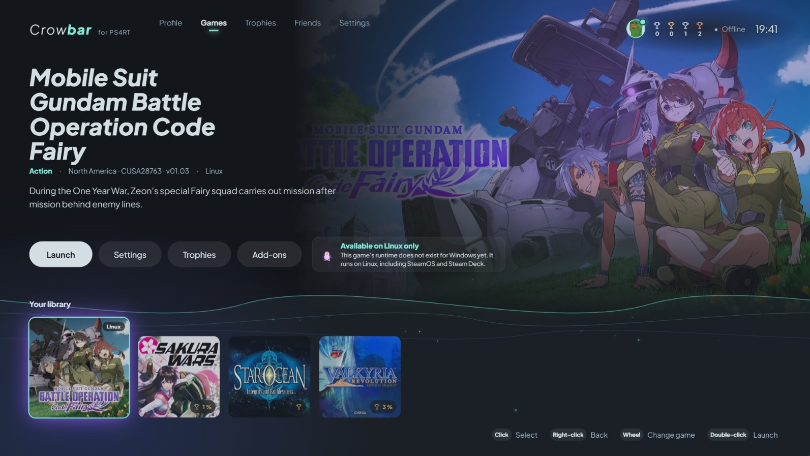

# Crowbar

**Crowbar** is a launcher for PS4RT runtimes. It finds your PS4 game dumps, installs and updates the right runtime for each game, and launches them, from a controller, a keyboard or a mouse.

**[Download the latest release](https://github.com/DiamondDogz/crowbar/releases)**: `Crowbar_*_x64-setup.exe` for Windows, `.AppImage` or `.deb` for Linux. Each file comes with its `.sha256`.

No game is included. Crowbar only runs games from your own dumps.

Version française plus bas.

  

## Games

| Game | Windows | Linux |
| --- | --- | --- |
| Sakura Wars | [Sakura-Wars-PS4RT-Windows](https://github.com/DiamondDogz/Sakura-Wars-PS4RT-Windows) | [Sakura-Wars-PS4RT](https://github.com/HekamiAeon/Sakura-Wars-PS4RT) |
| Valkyria Revolution | [Valkyria-Revolution-PS4RT-Windows](https://github.com/DiamondDogz/Valkyria-Revolution-PS4RT-Windows) | [valkyria-revolution-ps4rt](https://github.com/HekamiAeon/valkyria-revolution-ps4rt) |
| Star Ocean: Integrity and Faithlessness | [Star-Ocean-Integrity-and-Faithlessness-PS4RT](https://github.com/Hoverbike51/Star-Ocean-Integrity-and-Faithlessness-PS4RT) | [Star-Ocean-Integrity-and-Faithlessness-PS4RT](https://github.com/HekamiAeon/Star-Ocean-Integrity-and-Faithlessness-PS4RT) |
| Mobile Suit Gundam Battle Operation Code Fairy | coming | [GBO-Code-Fairy-PS4RT](https://github.com/HekamiAeon/GBO-Code-Fairy-PS4RT) |

**New:** Star Ocean on Windows now records trophies (Hoverbike51's runtime v1.0.0): Crowbar shows them, pops them up and keeps them in your profile.

The list of runtimes comes from [crowbar-catalog](https://github.com/DiamondDogz/crowbar-catalog), refreshed every hour.

## What it does

- **Library**: point Crowbar at the folder of your dumps. It reads each game's title, CUSA number, version and region, and shows the game's own icon, background and theme music.
- **Runtimes**:
  - installed for you on first launch, checked against their SHA-256;
  - updated automatically or on demand, on the stable or beta channel;
  - pinned to an exact version if you prefer;
  - your saves, trophies and settings follow every update, and the previous version stays available to go back to.
- **Offline trophies**: read from each game's `trophy00.trp`, with a Trophies screen, progress on every cover and a profile page. Nothing is sent anywhere.
- **Per-game settings**: resolution, display mode, FSR, frame rate and filtering. What you change in the in-game menu is kept.
- **Checks before launch**: game files and version, Vulkan 1.3 support and a controller. If something would stop the game, Crowbar says what to do.
- **Backups**: a dated copy of your saves, trophies and settings before every runtime change, with export, import and restore.
- **23 languages**, those of the PS4. As on the console, one system language serves both Crowbar and the games that follow it.
- **Console mode**: full screen, out of the way while you play, back when you quit. A Steam shortcut is available.
- **GitHub account**, optional: one press to star the runtimes you enjoy. Sign-in uses a device code, so no password goes through Crowbar.

## Screenshots

<table>
  <tr>
    <td colspan="2"></td>
  </tr>
  <tr>
    <td colspan="2" align="center"><i>Your library: each game with its own artwork and theme music.</i></td>
  </tr>
  <tr>
    <td colspan="2"></td>
  </tr>
  <tr>
    <td colspan="2" align="center"><i>Your profile: level, trophies earned and progress in each game.</i></td>
  </tr>
  <tr>
    <td width="50%"></td>
    <td width="50%"></td>
  </tr>
  <tr>
    <td align="center"><i>Checks before launch, in the bonus language: R'lyehian.</i></td>
    <td align="center"><i>Settings, in Canadian French, one of the 23 PS4 languages.</i></td>
  </tr>
</table>

## Requirements

- Windows 10 or 11 (x64), or a Linux desktop.
- A graphics card with Vulkan 1.3.
- Your own extracted PS4 game dumps.
- A controller is recommended, not required.

## Licence

Crowbar is free to download and use for personal use. Its source code is not public. See the licence shipped with each build. Crowbar includes third-party components under their own licences, listed in `THIRD-PARTY-NOTICES.txt` with every build.

Crowbar is not affiliated with Sony Interactive Entertainment or with the publishers of the games it launches. "PlayStation" and "PS4" are trademarks of their respective owners. The runtimes belong to their authors; credit for them stays with them.

---

# Crowbar (français)

**Crowbar** est un lanceur pour les runtimes PS4RT. Il trouve vos dumps de jeux PS4, installe et met à jour le bon runtime pour chaque jeu, et les lance, à la manette, au clavier ou à la souris.

**[Télécharger la dernière version](https://github.com/DiamondDogz/crowbar/releases)** : `Crowbar_*_x64-setup.exe` pour Windows, `.AppImage` ou `.deb` pour Linux. Chaque fichier est accompagné de son `.sha256`.

Aucun jeu n'est inclus. Crowbar ne lance que vos propres dumps.

  

## Jeux

| Jeu | Windows | Linux |
| --- | --- | --- |
| Sakura Wars | [Sakura-Wars-PS4RT-Windows](https://github.com/DiamondDogz/Sakura-Wars-PS4RT-Windows) | [Sakura-Wars-PS4RT](https://github.com/HekamiAeon/Sakura-Wars-PS4RT) |
| Valkyria Revolution | [Valkyria-Revolution-PS4RT-Windows](https://github.com/DiamondDogz/Valkyria-Revolution-PS4RT-Windows) | [valkyria-revolution-ps4rt](https://github.com/HekamiAeon/valkyria-revolution-ps4rt) |
| Star Ocean: Integrity and Faithlessness | [Star-Ocean-Integrity-and-Faithlessness-PS4RT](https://github.com/Hoverbike51/Star-Ocean-Integrity-and-Faithlessness-PS4RT) | [Star-Ocean-Integrity-and-Faithlessness-PS4RT](https://github.com/HekamiAeon/Star-Ocean-Integrity-and-Faithlessness-PS4RT) |
| Mobile Suit Gundam Battle Operation Code Fairy | à venir | [GBO-Code-Fairy-PS4RT](https://github.com/HekamiAeon/GBO-Code-Fairy-PS4RT) |

**Nouveau :** Star Ocean sous Windows enregistre désormais les trophées (runtime v1.0.0 de Hoverbike51) : Crowbar les affiche, les annonce et les garde dans votre profil.

La liste des runtimes vient de [crowbar-catalog](https://github.com/DiamondDogz/crowbar-catalog), mise à jour toutes les heures.

## Ce qu'il fait

- **Bibliothèque** : indiquez à Crowbar le dossier de vos dumps. Il lit le titre, le CUSA, la version et la région de chaque jeu, et affiche son icône, son fond et son thème musical.
- **Runtimes** :
  - installés pour vous au premier lancement, vérifiés par leur SHA-256 ;
  - mis à jour automatiquement ou à la demande, en canal stable ou bêta ;
  - fixés sur une version précise si vous préférez ;
  - vos sauvegardes, trophées et réglages suivent chaque mise à jour, et la version précédente reste disponible pour revenir en arrière.
- **Trophées hors ligne** : lus dans le `trophy00.trp` de chaque jeu, avec un écran Trophées, la progression sur chaque jaquette et une page Profil. Rien n'est envoyé.
- **Réglages par jeu** : résolution, affichage, FSR, images par seconde et filtrage. Ce que vous changez dans le menu en jeu est conservé.
- **Vérifications avant le lancement** : fichiers et version du jeu, Vulkan 1.3 et manette. Si quelque chose empêcherait le jeu de démarrer, Crowbar dit quoi faire.
- **Sauvegardes** : une copie datée de vos sauvegardes, trophées et réglages avant chaque changement de runtime, avec export, import et restauration.
- **23 langues**, celles de la PS4. Comme sur la console, une langue système sert à la fois à Crowbar et aux jeux qui la suivent.
- **Mode console** : plein écran, Crowbar s'efface pendant la partie et revient ensuite. Un raccourci Steam est disponible.
- **Compte GitHub**, facultatif : un appui pour mettre une étoile aux runtimes que vous aimez. La connexion se fait par code, aucun mot de passe ne passe par Crowbar.

## Captures d'écran

<table>
  <tr>
    <td colspan="2"></td>
  </tr>
  <tr>
    <td colspan="2" align="center"><i>Votre bibliothèque : chaque jeu avec ses images et son thème musical.</i></td>
  </tr>
  <tr>
    <td colspan="2"></td>
  </tr>
  <tr>
    <td colspan="2" align="center"><i>Votre profil : niveau, trophées obtenus et progression dans chaque jeu.</i></td>
  </tr>
  <tr>
    <td width="50%"></td>
    <td width="50%"></td>
  </tr>
  <tr>
    <td align="center"><i>Les vérifications avant le lancement, dans la langue bonus : le R'lyehian.</i></td>
    <td align="center"><i>Les paramètres, en français canadien, l'une des 23 langues de la PS4.</i></td>
  </tr>
</table>

## Configuration requise

- Windows 10 ou 11 (x64), ou un bureau Linux.
- Une carte graphique compatible Vulkan 1.3.
- Vos propres dumps de jeux PS4, extraits.
- Une manette est conseillée, pas obligatoire.

## Licence

Crowbar est gratuit à télécharger et à utiliser pour un usage personnel. Son code source n'est pas public. Voir la licence fournie avec chaque version. Crowbar inclut des composants tiers sous leurs propres licences, listés dans `THIRD-PARTY-NOTICES.txt` avec chaque version.

Crowbar n'est affilié ni à Sony Interactive Entertainment, ni aux éditeurs des jeux qu'il lance. « PlayStation » et « PS4 » sont des marques de leurs propriétaires respectifs. Les runtimes appartiennent à leurs auteurs, à qui revient leur crédit.
